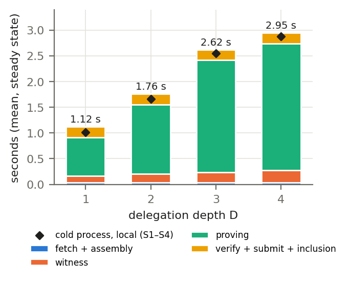
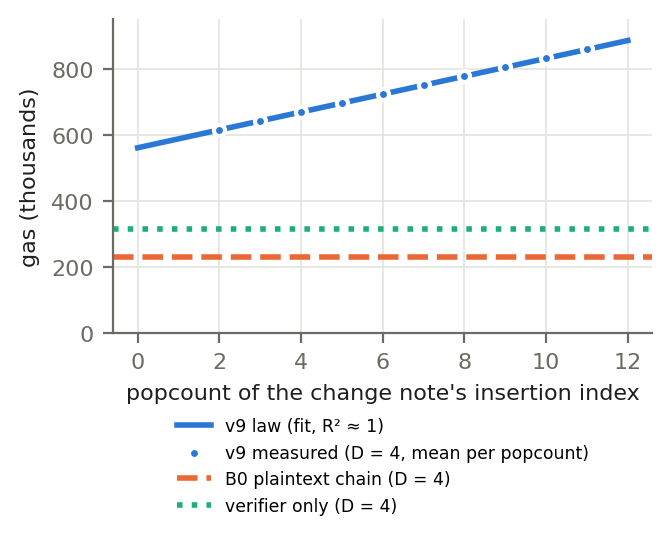
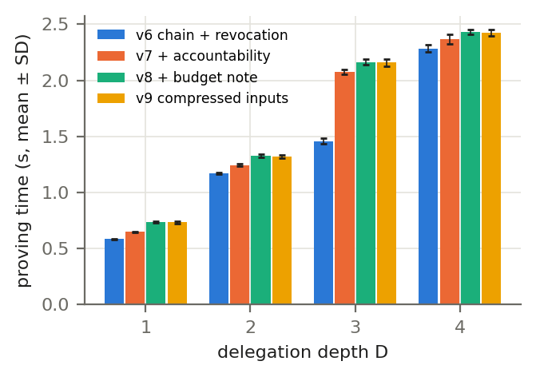

# ZK-DAC 实验结果交付报告（乙方，2026-10-15）

- **仓库**：`Winston-9527/zk-hada-exp`。基线为 main @ `eae5864`（含审计更正 PR #82）。审计补做实验 F1–F3 在 PR #83，**待合并**，本报告已经写入。
- **对照文件**：research design（`ttwang-szu/ZK-HADA @ 7966d60 : docs/research/proposals/2026-09-19_RESEARCH_DESIGN.md`，下称 RD）。
- **替代关系**：本报告替代 2026-10-11 的阶段报告（PR #51，保留为快照），纳入此后的全部工作：
<!-- audit -->
  - 审计 #53–#59 及其修复（PR #60）；
<!-- /audit -->
  - 下一轮 WP7–WP14 及 v9.1 / v9.2 / T7c（PR #62–#74）；
<!-- audit -->
  - 审计 #76–#81 及更正（PR #82）；
<!-- /audit -->
  - 补做实验 F1–F3（PR #83）。
- **证据规则**（`work/EVIDENCE_PROTOCOL.md`）：
  - 每个实验先推送预注册，再运行；
  - 失败的尝试全部保留；
  - 更正只追加在 RESULTS 末尾，不改写原文；
  - 每个目录有 RUN_RECORD 和 MANIFEST.sha256。
- 本报告所有数字都取自各实验目录的 RESULTS / JSON，并附路径。**有更正的，一律以更正后的数字为准。**

---

## 0. 一页摘要

- **主电路是 v9.2**（v9 + 每跳加密密钥的在曲线检查 + holder_sk ≠ 0）。
  - D = 1..4 时依次为 60,629 / 105,434 / 150,239 / 195,044 个约束，公开输入 17–20 个。
  - 两次修复都是真实漏洞，都有 PoC。修复后其他行为逐行不变：变异测试、T3 174 行、gate 测试 75/75、forge 380/380。
- **H1–H4 都有实证支撑。** 在 v9.2 上，除了已披露并由合约闭合的 POLICY 行，没有实验出现误接受。v9 和 v9.1 上发现的两处漏洞已经修复（§1）。
  - H1：T3 v9.2 共 174 行，误接受只有 20 行 POLICY（由合约闭合）和 1 行按设计接受。真实 gate 上做了 12 种替换，1,440/1,440 被拒。
  - H2：证书撤销和密钥撤销在 1,230 个 agent 的规模上都是 0 误放、0 误伤。被撤销后代的伪造 witness 全部被**真实电路**拒绝（T5b 301/301，T5d 6,279 次求值）。
  - H3：480 个多发送者 run 中没有一次超支，也没有一个 nullifier 被用两次（E2b）。
  - H4：2-of-3、3-of-5、5-of-9 委员会对每个 D 都精确打开；错误份额全部被拒并被追责（E6c 256/256）。
- **隐私（Q4）：在三类对手下都没有检出链接。**
  - 三类对手是外部观察者、被腐化的祖先、与验证者合谋的祖先（E6d 8 个世界；E6e 32 个 master）。
  - 检测能力已用阳性对照校准：配对 AUC ≳ 0.54–0.55 的泄漏可以可靠检出。
  - 比这弱的泄漏测不出来；单比特泄漏需要加入逐比特特征才能看见。
- **性能**：
  - D = 4 时本地证明约 2.6–2.9 s，三个工程目标全部达到；
  - v9.2 不比 v9.1 慢（平衡顺序重测，−2.1 % 到 +0.1 %）；
  - 证明时间与 agent 数 N 无关（N 最大到 10,000）；
  - execute gas 随 note 树下标增长，有显式模型。
- **可复现**：v9.1 和 v9.2 在第二环境（Linux x86_64）上构建逐字节一致；T3 逐行一致（包括失败位置）；forge 全部通过；缩小版 T5 的全部判定一致。
<!-- audit -->
- **审计**：两轮共 13 个审计 issue。
  - CRITICAL 的 #53 已在 v9.1 修复；#54 已通过 E6b2 修复。
  - 第二轮 #76–#81 的 finding 全部属实，已经逐条更正。主要是证据归属和表述问题，没有改变任何安全结论。
<!-- /audit -->
- **需要甲方处理**：论文 Q4 等 7 处与证据不一致（`work/t8_paper/PAPER_SYNC_NOTES_20261015.md`）；#11 的 52 项对齐清单；证明第 4 节按 v9.2 更新。

---

## 1. 电路版本与关键数字

| 版本 | 相对上一版的改动 | 约束数 D = 1 / 2 / 3 / 4 | 公开输入 | 依据 |
|---|---|---|---|---|
| v7 | 追责绑定放进动作电路 | — | — | #30 |
| v8 | + 私有预算 note（H3 方案 C） | — | — | #39，`zkdac_v8/` |
| v9 | 删减公开输入，压缩追责密文 | 60,622 / 105,424 / 150,226 / 195,028 | 17–20 | #41，`zkdac_v9/` |
| v9.1 | + 每跳加密密钥的在曲线检查（审计 #53） | 60,628 / 105,433 / 150,238 / 195,043 | 17–20 | `zkdac_v9_1/` |
| **v9.2** | + `sk_inv·holder_sk === 1`，即 holder_sk ≠ 0（T7c F-2） | **60,629 / 105,434 / 150,239 / 195,044** | 17–20 | `zkdac_v9_2/` |

- **v9.1（#53）**：
  - 在 v9 上，在第 j 跳放一个不在曲线上的中间密钥，witness 可满足（j = 0..3）；j = 3 时真实 proof 能通过验证，压缩打开在第 j 跳给出错误密钥。
  - v9.1 在 `BabyCheck L82` 拒绝全部四种情况。
  - 真实 gate 上：v9 gate 接受这个 proof，v9.1 gate 拒绝（E7c G7）。
- **v9.2（F-2）**：
  - 在 v9.1 上，如果签发者认证了单位元 O 作为持有者，holder_sk = 0 的 witness 可满足，真实 proof 能通过验证，任何人都能以这个持有者的身份行动。
  - v9.2 在新约束处 UNSAT。R1CS 层的检查确认：移植过来的 F-2 witness **只**违反这一条约束。
  - 链上：v9.1 gate 接受 F-2 proof，说明问题真实存在。"v9.2 gate 拒绝"只说明两版 VK 不同，不作为关闭的证据（#80 F1）。
- 两次修复之后，变异测试的接受集合、T3 每一行的分类、gate 测试、打开测试都与前一版逐行相同。可信设置：Hermez 2^18 phase 1 加一次本地 phase 2 贡献，**不是可信设置**。

---

## 2. 研究假设与猜想的当前状态

### 2.1 头条候选 H1–H5（RD 第 55–61 行）
| | 状态 | 主要证据 |
|---|---|---|
| H1 隐藏谱系下验证每次动作 | **实现并测试（v9.2）** | T3 174 行：一致拒绝 118，一致接受 28，仅 witness 错误 7；误接受 21 行，其中 20 行是 POLICY，由合约闭合（V9Policy 34/34），1 行按设计接受。真实 gate：1,440/1,440 替换被拒，120/120 重放被拒，4 个时间窗口都在边界上测过 |
| H2 撤销隐藏分支、保留兄弟 | **成立（电路证据）** | T5b：301/301 个被挡 agent 的伪造 witness 被电路拒绝。T5d 密钥撤销：0 误放、0 误伤，12 个世界，6,279 次电路求值。T5c I1：根重放在 t_e + Δ 之后被窗口挡住 |
| H3 子代理合计授权不增加 | **成立（实现 + 机检模型）** | E2：v7 下 640/100，v8/v9 下 100/100。E2b：480 个 run 0 超支。Lean T1/T2 和 T7c R1a 的细化（`exec_sound`） |
| H4 不可替换的追责对象 | **成立（可信 dealer 下）** | E6 65/65；E6c v9.1 256/256；gate 发出的 120 个密文 120/120 精确打开（O20）；X5 不可陷害 19/19 + 2/2 UNSAT |
| H5 可执行语义驱动的差分检查 | 已作为方法使用 | T3 穷举差分（534 个变异，语句层分歧 3 个）；T7c R1b（模型对实现，11,777 + 644 步）；第二环境逐行比对 |

### 2.2 可证伪猜想 Q1–Q6（RD 第 146–155 行）
| | 状态 | 说明 |
|---|---|---|
| Q1 动作 ↔ 唯一授权链与上下文 | **实证支持**（未证明） | 同上 H1；T7c 给出 69 条子句的 relation 和游戏草稿 |
| Q2 单根授权守恒 | **实证支持 + 模型机检** | E2、E2b、I2（1,674/1,674 接受，无超支）；Lean |
| Q3 撤销后后代不能行动、兄弟可用 | **实证支持 + 模型机检** | 同上 H2。代价：每次撤销后所有在途证明需重做一次（T5d 中 44,280/44,280 个撤销前交易在窗口后被拒） |
| Q4 同泄漏下谱系不可区分 | **实证支持，检测能力已校准** | 见 §3.5。master 链接和被腐化的祖先现在都可以检验，并且都没有检出。**论文的 Q4 段落尚未同步**（#78 F1） |
| Q5 opening 与责任密钥一致 | **实证支持** | E6c；#53 的修复保证了这一点 |
| Q6 同语义下性能可用 | **支持** | §3.6 |

---

## 3. 实验结果

### 3.1 正确性、攻击与真实 gate

| 实验 | 结果 | 目录 |
|---|---|---|
| T2 单字段变异（v9.2） | 每个 D 分别 199/282/408/534 个字段，接受集合与 v9.1 逐行相同（每个 D 都是 37 个，属于预期接受）；语义用例结果相同 | `t2_circuit_fix/zkdac_v9_2/` |
| T3 攻击与差分（v9.2） | 174 行：28 / 118 / 7 / 21；穷举差分 D = 4：534 / 89 / 3（与 v9.1 相同） | `t3_attacks/v9_2/` |
| E7c / E7d 真实 gate（v9.1 / v9.2） | 73/73、75/75。B1 成功 120/120（恰好执行一次，发出 `Accountability`）；B2 业务回滚 120/120；B3 替换 1,440/1,440 被拒；B4 重放 120/120 `BudgetSpent`；B5 四个时间窗口都在边界上接受、边界 + 1 拒绝（撤销窗口 Δ ∈ {0, 12, 60, 240} s，共 160/160）；B6 他人代为提交被接受（已披露：执行者不绑定） | `t4_contracts/E7c-*`、`E7d-*` |
| T7c relation 与证明映射 | 69 条子句、10 个游戏（草稿，交甲方）。X1 IMT 2,304/2,304；X2 Poseidon 4,000/4,000，Solidity 实现 1,000/1,000；X3 15/15 个变异 UNSAT；X5 19/19 + 2/2 UNSAT。R1a：Lean 中证明了 `exec_sound`，没有 sorry。R1b：模型与实现一致 11,777 + 644 步 | `t7_proofs/T7c-*` |
| 窗口边界变异测试（F3，#83） | 把撤销窗口的 `<=` 改成 `<`，原有的 `test_GB7` 能检出。**把 gate 的 `_rootOk` 改成 `<`，原有 V92 套件 11/11 仍然通过**，这是一个真实的测试缺口。新增 `T7cWindowBoundary.t.sol`（note 根和 issued 根两个窗口的边界）后可以检出。forge 380/380 | `audit_corrections/FOLLOWUPS_20261016/F3_windows/` |

**限定（审计 #76）**：T7c R1b 中"真实 witness 与客户端谓词 283/283 一致"的拆分是 237 个正例、18 个负例（全部是 TR-4 数额守恒）和 28 个没有计算 witness 的情况，**没有撤销 / 非成员的负例**。mock 运行里 41 % 的拒绝从未上链，只由客户端谓词判定，而 mock gate 接受了 8/9 的超额 execute。因此 R1 只支撑实现侧的两项检查：nullifier 和撤销根窗口。数额守恒和成员关系的证据是电路测试 X1 / X3 / T3。

### 3.2 撤销

| 实验 | 设置 | 结果 |
|---|---|---|
| E3 | 598 行 | 全部与预注册一致；消融 L 下后代 14/14 被误接受（"因果证据"的说法已撤回，#57） |
| T5b | T5 最终世界：120 条被撤销的边，301 个被挡 agent | v9 和 v9.1 上，前驱叶 witness 301/301 在 L67 被拒，自身叶 witness 301/301 在 L59 被拒；对照 64/64 被接受 |
| **T5c I1**（WP8） | 1,230 个 agent，撤销率 r ∈ {0, 1, 10} %，Δ ∈ {0, 30, 150, 600} s，3 个种子，逻辑时钟 | H1 = 0、H2 = 0（36/36 个 run）。Δ = 0、r = 10 % 时，非后代有 **5.99 % ± 1.27** 的暂时拒绝，尝试次数增加到 1.148 倍；Δ ≥ 30 s 时没有任何可用性损失，暴露时间的上限等于 Δ |
| **T5d**（WP9） | 密钥撤销，10 % / 30 % 的 agent 复用密钥，r ∈ {1, 10} %，12 个世界 | 方法 K（撤销密钥）和 E-oracle（撤销该密钥持有的所有证书）：误放 0、误伤 0。每笔撤销交易 273.5k gas。E-oracle 多用 0–75 % 的交易。只知道局部信息时（E-local），0–24 % 的目标仍在行动（每个世界最多 60 个） |

**I1 的限定（#76、#79）**：
- H1 = 0 测的是**合约窗口挡住根重放**。"新根无 witness = 0"在构造上必然成立，已移出硬检查。
- "被撤销后代不能在当前根上作证"的电路证据来自 T5b、T5d 和补做的电路对照：984 个受影响 agent，10,712 次真实 v9.2 求值，全部被拒。
- Δ 的结论只在逻辑时钟下成立（零传播延迟、下一块打包）。0 到 30 s 之间的 Δ 没有测试。
- Freedman–Lane 交互检验的前提不成立（12 个格子中 11 个方差为 0），所以"交互显著"只能按描述性理解。

**证书撤销条目没有加 salt（E3 L3）。** 撤销一条委托边时，撤销树里插入的条目就是这张证书的哈希：v9.2 中为 `cert[i] = Poseidon(i, 签发者公钥 Ax, Ay, 持有者公钥 Ax, Ay, cap, expiry)`（`zkdac_chain_v9.circom:120-125`），其中没有任何随机数。
- **谁能认出某条边被撤销了。**
  - 公开观察者认不出来（E3 L1：23 个撤销条目与 46 个动作的 994 个公开字逐一比对，0 个匹配）。
  - 签发者和这条边下面的所有后代本来就持有明文证书，能直接认出。
  - 知道这条边两端公钥、并且对 (cap, expiry) 有较窄先验的人，可以暴力枚举 cap 和 expiry 去撞哈希。E3 实测：cap ⊆ 0x3F、expiry ∈ [1000, 10000] 时，单线程 JS 用 137,016 次 Poseidon(7)、35 s 撞到。
  - 外推的单线程成本：cap 完全未知（32 位）且 expiry 精确到秒、范围一年，约 110 万年；cap 是已知 8 位父权限的子集、expiry 精确到秒，约 24 天；expiry 精确到小时，约 10 分钟。原生或 GPU 哈希要快几个数量级。
  - 密钥撤销条目 `H("zkrk", A)` 则是任何知道该公钥的人都能认出（E3 L2），这是设计如此。
- **增量泄漏有多大。** 能拿到两端公钥的通常是这条链上的参与者，或者打开过动作的审计方，他们本来就知道这条链。多出来的信息只是"这条边已被撤销"。
- **为什么没有修。** RD 第 27 行的第一版隐私目标是对**公开验证者**隐藏谱系，L1 表明这一点已经满足；H2 和止损条件与是否加 salt 无关；RD 第 253 行的泄漏函数已经允许"撤销后按设计暴露的 handle"。2026-10-09 用户决定：披露，不改电路。
- **与 RD 的偏差（已披露）。** RD 第 97 行设想撤销 handle 由独立秘密派生。实现用的是不加 salt 的证书哈希。第 97 行的核心要求（知道 handle 不足以撤销）属于撤销授权，由 `ZkDacRevocations` 保证，与 salt 无关。
- **如果需要更强的说法。** 在证书里加一个随机 salt 字段，需要改电路、重新做 setup，并重跑 T2 / T3 / E3，估计约 1 天。建议论文的泄漏函数写明："被撤销证书的条目，可被知道两端公钥且对 (cap, expiry) 有先验的一方认出；公开验证者认不出。"

### 3.3 预算与并发

| 实验 | 设置 | 结果 |
|---|---|---|
| E2 | 每轮竞争都在同一区块 | v7 下 640/100（v7 没有数量语义）；v8/v9 下 100/100；撤销后冻结 |
| **E2b**（WP7） | 16 个格子 × 30 个配对种子 = 480 个 run，真实 v9.2 proof，逻辑时钟 t_p = 1.377 s | 硬检查 480/480 成立：0 超支，每个 nullifier 至多使用一次，所有拒绝都是 `BudgetSpent`。**一个 note 会把 agent 串行化**（每块最多接受 1 笔，约 0.5 笔/s，这个值等于 1/(b·⌈t_p/b⌉)，是模型值）。事先拆分 note 能恢复并行：k = 128 时 B − A = +12.1 笔/s（Holm p 6e−4） |
| **T5c I2**（WP8） | 扇出 f ∈ {1, 8, 32} × 并发 k ∈ {1, 8, 32, 128}，3 个种子，真实 proof，30M gas，12 s 出块 | **1,674/1,674** 全部接受。打包延迟只取决于 k：128 笔需要 3 个块。树的固定成本 1.44M gas，每多一个 note 0.55–0.75M。execute gas 的 f×k 交互**全部来自 k < f 格子多备的 note**（k ≥ f 子集上交互份额为 6.5e−10），**只应引用 k ≥ f 的对比** |

E2b 的前提：同一 agent 的发送者共享钱包里的 note 集合（对 A 有利，所以 B − A 是保守估计）；没有覆盖网络延迟、费用市场和优先费。b = 2 时，82/90 个 run 的有效并行度略高于 1/b，这是端点效应。

### 3.4 追责（opening）

| 实验 | 结果 |
|---|---|
| E6（v7） | 65/65 |
| **E6c**（v9.1，第二环境，480 个真实 proof） | 256/256 行符合预注册。(2, 3)、(3, 5)、(5, 9) 委员会在所有 t 子集上精确打开；少于 t 份时打不开；强行做 Lagrange 插值恢复出的 0/5,838 个密钥落在曲线上。重复、跨事件、错误 epoch、错误 DLEQ 的份额全部被拒并被追责；替换密文时动作 proof 失败，成员拒绝出份额。gate 发出的 120 个密文 120/120 精确打开 |
| **T5c I3** 追责消融（v9.2 与去掉追责的 noacc 变体） | 追责的代价：约束 +6.5 % 到 +15.2 %，证明 +2.9 % 到 +7.7 %（+60 到 +96 ms），execute gas +12.4 % 到 +14.4 %（每跳约 7.7k）。Δexec 中约 2.1k 是实现假象（`selFor` 的冷 SLOAD）。目标合约的"预热"实际是存储预初始化，列为偏离 |

D = 4 时的打开耗时（第二环境，中位数）：成员出一份份额 51 ms；合并 193 / 280 / 469 ms（t = 2 / 3 / 5）。

**不支持**：DKG（dealer 可信）；t 个或更多成员合谋；链上验证打开；形式化证明。

### 3.5 隐私与可链接性（Q4）

| 实验 | 对手与规模 | fresh 结果 | 检测能力（阳性对照） |
|---|---|---|---|
| E6b / E6b2 | 外部观察者；512 条 transcript；C1 同一 agent、C2 兄弟 | 0/18 检出（Holm p 全部为 1） | P1 / P2 对照 18/18 检出。C3（master）在这个规模下无法检验 |
| **E6d**（WP10） | 8 个独立世界，D ∈ {2, 3, 4}，8,192 条真实 v9.2 transcript | 6 个格子都是 NO LINK，平均 AUC 0.494–0.503 | 主分析（A1 特征）**看不见单比特泄漏**（W1 ε = 0：0.507–0.511），按自己的规则 **C1 作废**。事后分析 A2 加入逐比特特征后，W1 的 logreg / rf 达到 0.69–0.76（8/8 个世界检出），k-NN 0.55（7–8/8）。配对 AUC ≥ 0.546 时，每个世界都能检出 |
| **E6e M1**（WP11） | 外部观察者；32 个 master × 4 个 parent × 4 个 agent；4,096 个 proof | 18 个格子 NO LINK，AUC 0.482–0.518；**master 任务 C3 首次可以检验**，AUC 0.490–0.513 | W1 / W2 / W3 在 ε = 0 时全部检出；W3 在 ε = 0.20 时 14/18 个格子检出 |
| **E6e M2**（被腐化的祖先） | 祖先掌握子树内所有公钥、证书和撤销 handle；字典精确匹配 0（2,883,584 个残差） | 12 个格子 NO LINK（Holm p ≥ 0.115）；top-1 命中率等于随机水平 | K1 单比特 keystream 缺陷：λ = 1 和 0.5 时全部检出，λ = 0.2 时只有 M2b-P 检出；K2（10 % 的 transcript 复用 keystream）检出 |
| **E6e M3**（祖先 + 合谋验证者） | M2 的特征加上验证者看到的信息 | NO LINK（Holm p ≥ 0.566） | K1 λ = 1 时检出 |
| **E6e M2/M3 置信区间**（F1，#83） | E6e M2/M3 的 cluster bootstrap 95 % CI，2,000 次重抽样 | 78/78 个格子的 AUC 和 p 与已提交结果相同。fresh：M2 的 12 个 CI 中 11 个含 0.5；例外是 **M2b-M rf 0.516 [0.503, 0.530]**，Holm p 0.115，不算检出；M3 6/6 含 0.5 | K1 λ = 1 的 logreg / rf：下界 0.629–0.753 |

**可以写进论文的说法**：在测试过的对手、特征和分类器下，没有检出超过已测 MDE 的链接；配对 AUC ≳ 0.54–0.55 的泄漏可以可靠检出。
- 不能说"不存在弱链接"。
- 不能把 E6b 的特征称为 "bit-level"：它们看不见单比特泄漏（#78 F1）。
- 0.006 是 Holm 校正的下限。

**未覆盖**：网络、付费者和时序侧信道；撤销条目（E3 L2/L3 的已知泄漏）；设计上允许的泄漏，包括主动撤销探测、委员会打开、祖先对自己子树的知识。

### 3.6 性能与规模

| 项目 | 结果 | 来源 |
|---|---|---|
| 本地计算 p95（v9，N = 30） | D = 1..4：927 / 1,578 / 2,449 / 2,855 ms；冷启动 p95 1,030–2,935 ms | T5、T5b |
| 工程目标（RD 第 300 行） | p95 2.86 s（≤ 10 s ✓）；峰值 RSS 4.51 GiB（≤ 8 GiB ✓）；验证器 gas 315k（≤ 500k ✓） | T5 |
| v9.2 与 v9.1 对比 | **平衡顺序 ABBA BAAB**：差值 −12.2 / −30.0 / −20.8 / +3.0 ms（−2.1 % 到 +0.1 %），32/32 个 block 验证通过。T8c 中的 +25 ms 来自固定的运行顺序 | 平衡顺序重测（#83）、T8c |
| 树高 h（T8e S1） | h 从 10 增加到 24，证明时间增加约 30 %；约束都在 2^18 以内；h = 10 时容量只有 1,024，不实用 | T8e |
| 深度 D = 8（T8e S2） | 375,148 个约束、24 个公开输入。**只编译过**，没有 setup、证明和完备性检验（需要 2^19 ptau，用户决定不做） | T8e |
| agent 数 N（T8e S3） | N = 32 到 10,000：证明时间变化在 ±5 % 以内；客户端镜像在 N = 10,000 时 1.6 MB，重建 13.2 s；凭证签发约 0.45 s/个 | T8e |
| execute gas | 探索性模型（事后拟合）：463,747 + 27,080·popcount + 7,753·D + 5,162·bit_length；N = 10,000 时 706–784k；树满 2^20 时约 0.87M（外推）。每个 run 的首个动作多 34–54k | T8e、T5 |
| 隐私成本（相对明文参照门 B0） | 空树时 2.45–6.70 倍，T5 世界规模时 3.25–8.63 倍（取决于计量口径） | T6b |
| 组件成本 | 追责（v6→v7）+65 到 +620 ms；预算（v7→v8）+63 到 +87 ms；v9 压缩最多快 7 ms | T6b |

**图 F1　本地授权路径各阶段耗时（v9，T5，稳态均值）。** 证明阶段占绝大部分；菱形为冷启动进程的本地耗时（S1–S4）。v9.2 只多 1 个约束，阶段结构不变。来源：`t8_paper/T8-chapter_20261010/figures/`。

**图 F2　execute gas 与找零 note 插入下标的 popcount（v9，D = 4）。** 蓝线为 T5 的拟合，点为实测均值；橙色虚线为明文参照门 B0（不是下界），绿色点线为单独的验证器 gas。T8e 在更大的下标范围上加入了 bit_length 项，见 §3.6 表格。

**图 F3　各组件对证明时间的增量（T6，均值 ± SD）。** v6 链 + 撤销 → v7 加追责 → v8 加预算 note → v9 压缩公开输入。T6b 的配对检验：追责 +65 到 +620 ms，预算 +63 到 +87 ms，v9 压缩最多快 7 ms。

**计时规则**：所有时间数字都来自 Mac M5 Pro。同一台机器上，不同会话之间的绝对值会漂移约 5 %，所以只引用配对的、注明日期的数字。计时期间机器负载不是零（load average 最高约 14），"idle"的意思只是"没有本项目的其他进程"。

### 3.7 应用负载（E8，WP12）

| 应用 | 结果 |
|---|---|
| 全部 | 已知的越权尝试中，**363 次被电路或 gate 真实拦截**（A1 150 次、A2 120 次、A3 93 次），**0 次被接受**。另有 6 次是 harness 报错（归为无法测试），A3 的撤销攻击有 21 次没有测到（其中 seed 29 实际可以测试，被误归类） |
| A1 工具网关 | 85.3 % 提交（95 % CI 82.3–88.0 %），6.1 % 处于不确定状态（注入的崩溃概率 p = 0.05），这是链下效果非原子性的实测值。**网关不绑定 (id, tool)，也不限制只服务一次**，所以 A1 只是授权层的替身 |
| A2 ERC-20 金库 | 510/510 结算；资金不足时整笔回滚（30/30），补足后用同一 note 重试成功 |
| A3 有界采购 | 25/30 个任务成功（83 %）。12 件无法分配的商品中，**10 件是因为缺少有能力的子代理**，2 件是因为预算耗尽 |
| 延迟（Mac） | 证明阶段占本地路径的 88 %（D = 2）和 91 %（D = 3） |

trace 是确定性生成的，没有使用真实的 LLM agent（用户决定）。不涉及 prompt injection。

### 3.8 可复现性

| 实验 | 结果 |
|---|---|
| T8 clean build | C1–C5 全部通过 |
| **T8b**（v9.1） | Linux x86_64 上全新克隆：24/24 个 r1cs / wasm 与 macOS arm64 **逐字节一致**；12/12 个 zkey 通过验证；forge 288/288；T3、穷举差分、E6 逐行一致；跨平台 proof 互验 40/40 + 40/40 |
| **T8c C**（v9.2） | 8/8 逐字节一致；4/4 个 zkey OK；forge 367/367；跨平台 40/40 + 40/40 |
| **T8d**（WP13） | T3 v9.1 和 v9.2 在第二环境上 174/174 行、0 个字段不同（包括失败位置）；缩小版 T5（182 个 agent）的全部判定一致；gas 最多差 84（calldata 中零字节和非零字节的计价不同） |

**限定**：两台机器由同一个操作者运行，所以这**不是独立第三方复现**。`t8_paper/T8b-v91-repro_20261013/repro/README.md` 已经为第三方准备好。

---

## 4. 负结果、限制与已知问题（累计）

| # | 问题 | 状态 |
|---|---|---|
| 1 | 历史电路可以被绕过；论文中多个数字没有出处 | 已从可信最小关系重建 |
| 2 | 证书撤销条目没有加 salt：知道两端公钥并对 (cap, expiry) 有先验的人可以暴力认出某条边已被撤销（E3 L3）；公开观察者认不出 | 已披露，未修（用户决定，2026-10-09）；详见 §3.2 |
| 3 | 每次撤销后，所有在途证明在 Δ 之后都要重做 | 已实测，列为可用性代价 |
| 4 | 门限打开依赖可信 dealer；t 个或更多成员可以打开任意动作 | 已披露；DKG 没有做 |
| 5 | gate 的 TPK 不可变，构造函数不检查 TPK（F-1、GAP-1） | 已披露；链下有 `validCommittee` |
| 6 | 执行者不绑定，他人可以抢先提交（B6） | 已披露（POLICY） |
| 7 | 一个 note 会把一个 agent 串行化（E2b） | 设计性质；可以事先拆分 note |
| 8 | 非托管预算会滞留在故障子代理处，并且需要能力冗余（E8 A3） | 设计性质；已披露 |
| 9 | 链下效果与链上花费不是原子的（E8 A1 中 6.1 % 不确定） | 用预留 / 提交语义显式化 |
| 10 | execute gas 随 note 树下标增长 | 给出 gas 时必须注明树的规模 |
| 11 | D = 8 只编译过；D > 4 时 note 格式会改变 | 已披露 |
| 12 | 隐私：比 MDE 弱的泄漏测不出来；E6b 的特征看不见单比特泄漏；侧信道没有覆盖 | 已披露；论文需要同步 |
| 13 | 密码学部分没有形式化证明；历史 Lean 文件不能引用 | GAMES 草稿交给甲方；A-wSE 和 A-PRF 需要写进论文 |
| 14 | 可信设置：只有一次本地 phase 2 贡献；注册电路用的是本地开发 ptau 2^17 | 只能称为评估用密钥 |
| 15 | mainnet-fork 和第二种执行客户端都没有跑 | 未做 |
| 16 | 论文中的安全参数（2^-128、2^-126）需要按 BN254 重新计算 | 交给甲方 |
| 17 | 主 master 密钥（ent[1]）不做密钥撤销检查 | 预注册时已声明的限制 |
| 18 | T7c 的抽象函数 α 不比较金额、lineage 等；lineage 槽位上限的抽象差异没有列出 | 部分披露；后者是遗留项 |
| 19 | E6d C2 的 CI 仍然按 agent 做聚类 | 已披露，没有重算 |

---

## 5. 需要甲方处理的事项

乙方不修改 `paper.tex` / `experiments.tex`。下面是论文与证据不一致的地方，完整内容在 `work/t8_paper/PAPER_SYNC_NOTES_20261015.md`。

1. **Q4 隐私功效**（`experiments.tex:66-72`）：改用经验 MDE ≳ 0.54–0.55；写明 E6b 特征对单比特泄漏的盲区；删除或限定 "bit-level"；注明 0.006 是 Holm 下限。
2. **预算竞争**（`experiments.tex:158`）：改用 E2b 的结果；注明所有秒数都是逻辑时钟下的秒。
3. **撤销"0 误放"**：引用 T5d、T5b 和电路对照，不引用 T5c I1。
4. **T5c I1 的窗口结论**：只在逻辑时钟下成立。
5. **E8**：A1 是授权层的替身；A3 的失败主要来自能力覆盖不足。
6. **T7c R1**：只支撑 nullifier 和撤销根窗口这两项检查。
7. **计时来源**：定稿前重新核对；绝对时间只引用配对的、注明日期的数字。
8. **#11 对齐清单的 52 项**：第 4 节按 v9.2 更新（G-ANON、G-REV、T-NFF；新增 G-BUD、G-CTX、G-REG、G-REVAUTH）；相关工作补上 ZKM 和 ZEBRA；可信设置如实写明。

## 6. 未决事项与建议的下一步

| 优先级 | 事项 | 说明 |
|---|---|---|
| P0 | 合并 PR #83 | F1–F3 的补做实验，已验证 |
| P0 | 甲方整合 §5 的内容，并按 v9.2 更新证明 | 依赖甲方 |
| P1 | 审计方确认 #76–#81 的回复，并关闭 issue | 依赖审计方 |
| P1 | 处理 PR #52（AUDIT_GUIDE，含 #59 的遗留项）、#51（10-11 快照）、#61（计划），决定去留 | #32 按约定保持 open |
| P1 | 由独立第三方按 `t8_paper/T8b-v91-repro_20261013/repro/README.md` 复现 | 目前两台机器由同一个操作者运行 |
| P2 | 部署前提：phase 2 仪式、注册电路改用公开的 phase 1、DKG | 当前只能声称"评估用密钥" |
| P2 | 可选：D = 8 的 setup（需要 2^19 ptau）；mainnet-fork；撤销条目加 salt；A14 在部署值 SKEW 下测试 | 不影响当前研究目标 |

---

## 附录 A：实验目录与 PR 索引

| 实验 | 目录（`work/` 下） | PR |
|---|---|---|
| v9.1 | `t2_circuit_fix/zkdac_v9_1/`、`t3_attacks/v9_1/` | #60 |
| E6b2、T6b、T5b、V9Policy | `t4_privacy/E6b2-*`、`t6_baselines/T6b-*`、`t5_e2e/T5b-*`、`t4_obligations/E7b-*` | #60 |
| T8b、E7c、E6c | `t8_paper/T8b-*`、`t4_contracts/E7c-*`、`t4_accountability/E6c-*` | #62 |
| T7c | `t7_proofs/T7c-*` | #63 |
| v9.2、E7d | `t2_circuit_fix/zkdac_v9_2/`、`t4_contracts/E7d-*` | #64 |
| E6d（WP10） | `t4_privacy/E6d-*` | #65 |
| E6e（WP11） | `t4_privacy/E6e-*` | #66 |
| T5c I1 / I3（WP8） | `t5_e2e/T5c-*` | #67 |
| T8c | `t8_paper/T8c-*` | #68 |
| T5d（WP9） | `t5_e2e/T5d-*` | #69 |
| E2b（WP7） | `t5_e2/E2b-*` | #70 |
| T8d（WP13） | `t8_paper/T8d-*` | #71 |
| T5c I2（WP8） | `t5_e2e/T5c-*` | #72 |
| E8（WP12） | `t9_apps/E8-*` | #73 |
| T8e（WP14） | `t8_paper/T8e-*` | #74 |
| 审计更正 #76–#81 | `audit_corrections/AUDIT_R76-81_20261015.md`、`t8_paper/PAPER_SYNC_NOTES_20261015.md` | #82 |
| 补做实验 F1–F3 | `audit_corrections/FOLLOWUPS_20261016/` | #83（待合并） |

更早的实验（E0–E8 的第一轮：T1–T6、E2、E3、E6、E6b、E7、T7b、T8）见 2026-10-11 阶段报告（PR #51）及各目录。

## 附录 B：环境
- **第一环境**：Apple M5 Pro，macOS arm64，node 24.14.1，circom 2.2.3，snarkjs 0.7.6，forge 1.5.1。所有计时都来自这台机器。
- **第二环境**：RTX6000（`enine`），Ubuntu 22.04，Intel Xeon w7-3445 × 40。用于 T8b、T8c C、T8d、E6c、E7c，以及 E2b、I2、E8 的批量运行（只报告判定和 gas，不报告时间）。

## 附录 C：详细数据表

正文只列了汇总。本附录收录各实验 RESULTS 中的主要数据表，数字原样照录；有更正的，以更正后的数字为准，并加了注。

### C.1 T3 攻击与差分套件（各版本汇总）
| 版本 | 行数 | 一致接受 | 一致拒绝 | 仅 witness 错误 | 误接受（POLICY / 按设计） | 来源 |
|---|---|---|---|---|---|---|
| v9 | 170 | 28 | 114 | 7 | 21（20 / 1） | `t3_attacks/v9/` |
| v9.1 | 174 | 28 | 118 | 7 | 21（20 / 1） | `t3_attacks/v9_1/`，新增 A24 × 4 一致拒绝 |
| v9.2 | 174 | 28 | 118 | 7 | 21（20 / 1） | `t3_attacks/v9_2/`，每行分类与 v9.1 相同 |

### C.2 真实 gate 上的测量（E7c，v9.1，第二环境，n = 30）
| D | 1 | 2 | 3 | 4 |
|---|---|---|---|---|
| execute gas（B1，不含 intrinsic 和 calldata），中位数 / p95 | 483,725 / 603,395 | 491,047 / 610,717 | 498,369 / 618,039 | 505,691 / 625,361 |
| v9.1 证明时间（fullProve，ms），中位数 / p95 | 1,246 / 1,313 | 1,963 / 2,086 | 2,835 / 2,908 | 3,135 / 3,225 |

同一 D 内的 gas 离散（SD 49,516）来自 B1 顺序执行时的 note 树插入位置。第二环境的计时不作为结论。

### C.3 撤销窗口 Δ 的模拟（E3.5，每格 10^5 个诚实动作，被误判过期的比例）
| 根更新频率 | Δ = 0 | Δ = 12 s | Δ = 60 s | Δ = 240 s |
|---|---|---|---|---|
| 每小时 1 次 | 0.57 % | 0.25 % | 0 | 0 |
| 每分钟 1 次 | 28.8 % | 13.0 % | 0 | 0 |
| 每 12 s 1 次 | 81.0 % | 48.6 % | 0 | 0 |

模型参数（打包延迟、Poisson 更新）不是测量值。Δ ≥ 证明加打包时间（这个模型中最多约 26.5 s）之后，误判降为 0。

### C.4 T5c I1：撤销率 r × 窗口 Δ（3 个种子的均值 ± SD，逻辑时钟）
| r | Δ | 暂时拒绝 | 每次成功动作的尝试数 | 每条被撤销边的平均暴露（s） | 最大暴露（s） |
|---|---|---|---|---|---|
| 10 % | 0 | 5.99 % ± 1.27 | 1.148 ± 0.017 | 0 | — |
| 10 % | 30 s | 0 | 1.000 | 14.1 ± 0.8 | 30 |
| 10 % | 150 s | 0 | 1.000 | 133.1 ± 1.1 | 150 |
| 10 % | 600 s | 0 | 1.000 | 580.5 ± 2.7 | 600 |
| 1 % | 0 | 0 | 1.031 ± 0.005 | 0 | — |
| 1 % | 30 s | 0 | 1.000 | 17.4 ± 2.6 | 28–30 |
| 1 % | 150 s | 0 | 1.000 | 137.4 ± 1.5 | 148–150 |
| 1 % | 600 s | 0 | 1.000 | 585.1 ± 5.5 | 598–600 |
| 0 % | 任意 | 0 | 1.000 | — | — |

所有拒绝都是 `StaleRevokedRoot`。交互检验的前提不成立，只能按描述性理解（见 §3.2）。

### C.5 T5d 密钥撤销：成本与覆盖（3 个种子的均值 ± SD）
| 复用比例 s | 撤销率 r | 被撤销密钥（其中共享） | 目标数 | K 交易数 | E-oracle 交易数 | E-oracle / K | 撤销 gas K（M） | 撤销 gas E-oracle（M） | E-local 覆盖率 | E-local 下仍在行动的目标 |
|---|---|---|---|---|---|---|---|---|---|---|
| 10 % | 1 % | 11（1.0 ± 1.0） | 46 ± 32 | 11 | 12.3 ± 1.5 | 1.00–1.27 | 3.01 | 3.37 | 0.90–1.00 | 0–3 |
| 10 % | 10 % | 108（12.3 ± 2.5） | 302 ± 37 | 108 | 121.7 ± 2.5 | 1.10–1.15 | 29.5 | 33.3 | 0.93–0.97 | 12–19 |
| 30 % | 1 % | 8（3.3 ± 2.1） | 46 ± 40 | 8 | 11.7 ± 2.5 | 1.13–1.75 | 2.19 | 3.19 | 0.80–0.96 | 1–6 |
| 30 % | 10 % | 84（33.0 ± 1.7） | 303 ± 49 | 84 | 121.0 ± 1.7 | 1.42–1.45 | 23.0 | 33.1 | 0.76–0.89 | 36–60 |

### C.6 E2b：多发送者竞争（30 个种子的均值；范围为 b = 1 s 到 b = 2 s）
| 格子 | 预算 | 接受动作数（最小–最大） | 接受单位 | 停止原因：重试上限 / 已耗尽 | 尝试数 | 每块最多接受 | 有效并行度（笔/s） | 延迟 p50 / p95（s） |
|---|---|---|---|---|---|---|---|---|
| A，k = 1 | 100 | 1 | 10 | 0 / 0 | 1.0 | 1 | 0.55（b = 1 s），0.45（b = 2 s） | 1.9 / 2.3 |
| A，k = 8 | 100 | 4.2–4.7（4–5） | 42–47 | 3.3–3.8 / 0 | 25 | 1 | 0.49 | 4.2–5.1 / 8.2–9.0 |
| A，k = 32 | 100 | 5.0（5–5） | 50 | 27 / 0 | 121 | 1 | 0.50 | 4.8–5.4 / 8.3–9.0 |
| A，k = 128 | 1,280 | 5.0（5–5） | 50 / 1,280 | 123 / 0 | 505 | 1 | 0.50 | 5.0–5.5 / 8.3–9.1 |
| B，k = 1 | 100 | 1 | 10 | 0 / 0 | 1.0 | 1 | 0.55，0.45 | 同 A |
| B，k = 8 | 100 | 8.0 | 80 | 0 / 0 | 11 | 5–6 | 1.29–1.30 | 2.0–2.7 / 5.7–6.0 |
| B，k = 32 | 100 | 10.0 | 100 / 100 | 0 / 22 | 39–43 | 9 | 2.40–2.90 | 1.7–1.9 / 2.3–3.8 |
| B，k = 128 | 1,280 | 124.4–125.7（122–128） | 1,244–1,257 | 2.3–3.6 / 0 | 202 | 44–57 | 12.6 | 2.1–2.9 / 6.3–7.2 |

按种子配对的有效并行度差 B − A（k ≥ 8）：

| k，b | 均值 B − A（笔/s） | 配对 bootstrap 95 % CI | Holm p |
|---|---|---|---|
| 8，1 s | +0.80 | [0.71, 0.88] | 6e−4 |
| 8，2 s | +0.81 | [0.72, 0.90] | 6e−4 |
| 32，1 s | +2.40 | [2.21, 2.59] | 6e−4 |
| 32，2 s | +1.89 | [1.77, 2.00] | 6e−4 |
| 128，1 s | +12.15 | [12.01, 12.31] | 6e−4 |
| 128，2 s | +12.09 | [12.05, 12.13] | 6e−4 |

每笔成功动作的 gas：A 为 551k，B（k = 128）为 643k，因为 B 的 note 树更大（约 253 片叶子，A 为 6 片）。

### C.7 T5c I2：扇出 f × 并发 k
execute gas 均值（括号内为最终 note 数），取自 `results/i2/stats.json`：

| f \ k | 1 | 8 | 32 | 128 |
|---|---|---|---|---|
| 1 | 608,120 (33) | 608,453 (51) | 623,764 (99) | 658,519 (387) |
| 8 | 640,042 (173) | 608,455 (51) | 623,763 (99) | 658,519 (387) |
| 32 | 650,354 (653) | 618,776 (147) | 623,758 (99) | 658,514 (387) |

树成本（M gas）：

| k | 包含全部 k 笔所需块数 | 整棵树 f = 1 / 8 / 32 | 每条链 f = 1 / 8 / 32 |
|---|---|---|---|
| 1 | 1 | 6.9 / 51.9 / 224.1 | 6.94 / 6.49 / 7.00 |
| 8 | 1 | 10.5 / 10.5 / 41.6 | 10.53 / 1.32 / 1.30 |
| 32 | 1 | 20.5 / 20.6 / 20.5 | 20.51 / 2.57 / 0.64 |
| 128 | 3（平均延迟 1.94 块） | 85.7 / 86.0 / 86.0 | 85.75 / 10.75 / 2.69 |

k < f 的格子（k = 1 且 f = 8 或 32；k = 8 且 f = 32）多备了不会用到的 note，所以只引用 k ≥ f 的对比。

### C.8 T5c I3：追责的代价（v9.2 与 noacc 变体）
| D | 约束 on / off（差值，占比） | 公开输入 on / off | 证明 ms on / off（差值，占比） | 验证器交易 gas 差 | execute gas on / off（差值，占比） | calldata 字节 on / off |
|---|---|---|---|---|---|---|
| 1 | 60,629 / 51,401（+9,228，15.2 %） | 17 / 8 | 780.9 / 720.6（+60，7.7 %） | +64,431 | 588,842 / 515,969（+72,873，12.4 %） | 1,060 / 804 |
| 2 | 105,434 / 95,079（+10,355，9.8 %） | 18 / 8 | 1,388.4 / 1,326.6（+62，4.5 %） | +71,578 | 623,684 / 543,065（+80,619，12.9 %） | 1,092 / 804 |
| 3 | 150,239 / 138,757（+11,482，7.6 %） | 19 / 8 | 2,294.7 / 2,199.1（+96，4.2 %） | +78,737 | 631,436 / 543,065（+88,371，14.0 %） | 1,124 / 804 |
| 4 | 195,044 / 182,435（+12,609，6.5 %） | 20 / 8 | 2,575.1 / 2,501.3（+74，2.9 %） | +85,944 | 666,266 / 570,117（+96,149，14.4 %） | 1,156 / 804 |

execute gas 的差值里约有 2.1k 是实现假象（原版 gate 多一次 `selFor` 冷 SLOAD）。

### C.9 E6c 打开耗时（D = 4，第二环境，每个委员会 30 个动作，中位数）
| 委员会 | 动作 proof 验证 | 成员出份额（部分解密 + DLEQ） | 每份 DLEQ 验证 | 合并 + 解密（t 份） |
|---|---|---|---|---|
| (2, 3) | 9.6 ms | 51 ms | 76 ms | 193 ms（p95 259） |
| (3, 5) | 10.3 ms | 53 ms | 76 ms | 280 ms（p95 384） |
| (5, 9) | 9.8 ms | 51 ms | 76 ms | 469 ms（p95 631） |

### C.10 E6d 阳性对照（每格：8 个世界的平均 AUC · p < 0.01 的世界数；加粗 = 合并检出）
主分析（A1 特征）：

| 对照 | C1 logreg | C1 rf | C1 knn | C2 logreg | C2 rf | C2 knn |
|---|---|---|---|---|---|---|
| W1 ε = 0 | 0.507 · 0/8 | 0.511 · 1/8 | 0.507 · 0/8 | 0.506 · 1/8 | **0.522 · 4/8** | **0.520 · 4/8** |
| W2 ε = 0 | **0.557 · 8/8** | **0.565 · 8/8** | 0.507 · 0/8 | **0.567 · 8/8** | **0.581 · 8/8** | **0.514 · 1/8** |
| W3 ε = 0 | **0.759 · 8/8** | **0.760 · 8/8** | **0.753 · 8/8** | **0.761 · 8/8** | **0.762 · 8/8** | **0.761 · 8/8** |
| W3 ε = 0.30 | **0.511 · 1/8** | **0.521 · 2/8** | 0.506 · 0/8 | **0.516 · 1/8** | **0.532 · 6/8** | **0.516 · 2/8** |

事后分析 A2（加入逐比特特征）：

| 对照 | C1 logreg | C1 rf | C1 knn | C2 logreg | C2 rf | C2 knn |
|---|---|---|---|---|---|---|
| W1 ε = 0 | **0.692 · 8/8** | **0.754 · 8/8** | **0.547 · 7/8** | **0.714 · 8/8** | **0.757 · 8/8** | **0.552 · 8/8** |
| W2 ε = 0 | **0.525 · 3/8** | **0.546 · 8/8** | 0.504 · 0/8 | **0.529 · 6/8** | **0.552 · 7/8** | 0.507 · 0/8 |
| W3 ε = 0 | **0.725 · 8/8** | **0.756 · 8/8** | **0.732 · 8/8** | **0.740 · 8/8** | **0.760 · 8/8** | **0.749 · 8/8** |
| W3 ε = 0.30 | 0.508 · 0/8 | **0.515 · 2/8** | 0.504 · 0/8 | 0.506 · 0/8 | **0.526 · 3/8** | 0.507 · 1/8 |

两种分析中，ε ≥ 0.30 的 W1 / W2 和 ε ≥ 0.40 的 W3 都没有检出。fresh transcript 在两种分析下都是 NO LINK。W2 在 ε = 0 时的理论上限是 0.609。

### C.11 E6e M1 外部观察者的阳性对照（各格取模型和特征集中的最佳 AUC；✓ = Holm < 0.01）
| 通道 | ε = 0 | ε = 0.20 | ε = 0.30 | ε = 0.40 | MDE：C1 / C2 / C3 |
|---|---|---|---|---|---|
| W1 载荷比特 | ✓ 只有 F2 特征检出（rf 0.755 / 0.765 / 0.747）；F1 ≤ 0.528 | 只有 C1 F2 rf 0.544 ✓ | 未检出 | 未检出 | 0.20 / 0 / 0 |
| W2 时序 +30 s | ✓（F1 rf 0.584 / 0.578 / 0.580） | 未检出 | 未检出 | 未检出 | 0 / 0 / 0 |
| W3 0/1 字 | ✓（0.72–0.77，全部格子） | ✓ 14/18 个格子（0.538–0.609） | C3 F1 rf 0.544、knn 0.540 ✓ | 未检出 | 0.20 / 0.20 / 0.30 |

### C.12 E6e M2 被腐化的祖先：AUC 与 95 % cluster bootstrap CI（`FOLLOWUPS_20261016/F1_e6e_ci/m2_ci.json`；加粗 = Holm 检出）
| 任务 / 模型 | fresh | K1 λ = 1 | K1 λ = 0.5 | K1 λ = 0.2 | K1 λ = 0.1 | K2 λ = 0.1 |
|---|---|---|---|---|---|---|
| M2a-M logreg | 0.489 [0.470, 0.509] | **0.746 [0.629, 0.792]** | **0.614 [0.559, 0.643]** | 0.520 [0.496, 0.540] | 0.499 [0.481, 0.519] | — |
| M2a-M rf | 0.496 [0.479, 0.511] | **0.752 [0.643, 0.794]** | **0.599 [0.556, 0.624]** | 0.508 [0.485, 0.529] | 0.508 [0.488, 0.527] | — |
| M2a-M knn | 0.500 [0.481, 0.519] | **0.561 [0.537, 0.579]** | **0.520 [0.504, 0.534]** | 0.505 [0.487, 0.523] | 0.502 [0.481, 0.521] | — |
| M2a-P logreg | 0.497 [0.480, 0.515] | **0.748 [0.724, 0.762]** | **0.604 [0.580, 0.626]** | 0.519 [0.500, 0.537] | 0.506 [0.487, 0.524] | — |
| M2a-P rf | 0.508 [0.485, 0.530] | **0.747 [0.722, 0.762]** | **0.569 [0.552, 0.587]** | 0.511 [0.492, 0.531] | 0.497 [0.479, 0.517] | — |
| M2a-P knn | 0.505 [0.483, 0.527] | **0.541 [0.519, 0.563]** | 0.510 [0.486, 0.533] | 0.509 [0.488, 0.532] | 0.504 [0.483, 0.526] | — |
| M2b-P logreg | 0.501 [0.488, 0.515] | **0.767 [0.745, 0.785]** | **0.619 [0.603, 0.634]** | **0.522 [0.508, 0.536]** | 0.508 [0.495, 0.522] | **0.550 [0.539, 0.561]** |
| M2b-P rf | 0.511 [0.498, 0.524] | **0.771 [0.753, 0.788]** | **0.588 [0.574, 0.602]** | 0.509 [0.496, 0.522] | 0.505 [0.491, 0.518] | **0.538 [0.524, 0.550]** |
| M2b-P knn | 0.494 [0.482, 0.505] | **0.546 [0.532, 0.559]** | 0.511 [0.500, 0.523] | 0.500 [0.488, 0.512] | 0.495 [0.483, 0.507] | **0.551 [0.539, 0.564]** |
| M2b-M logreg | 0.500 [0.482, 0.515] | **0.754 [0.743, 0.765]** | **0.602 [0.590, 0.614]** | 0.520 [0.505, 0.533] | 0.507 [0.491, 0.522] | **0.544 [0.525, 0.562]** |
| M2b-M rf | 0.516 [0.503, 0.530] | **0.748 [0.741, 0.754]** | **0.570 [0.554, 0.586]** | 0.512 [0.500, 0.525] | 0.507 [0.496, 0.515] | **0.554 [0.544, 0.565]** |
| M2b-M knn | 0.490 [0.476, 0.505] | **0.525 [0.513, 0.538]** | 0.497 [0.483, 0.509] | 0.492 [0.478, 0.506] | 0.490 [0.475, 0.505] | **0.545 [0.527, 0.565]** |

- K1 是单比特 keystream 缺陷，理论上限：λ = 1 时 0.75，λ = 0.5 时 0.625，λ = 0.2 时 0.55，λ = 0.1 时 0.525。
- fresh 一列只有 M2b-M rf 的 CI 不含 0.5，但它的 Holm p 是 0.115，不算检出。
- M3（加上验证者视角）：fresh 的 6 个 CI 全部含 0.5（AUC 0.491–0.508）；K1 λ = 1 时 6/6 检出（0.539–0.768）。

### C.13 证明时间：v9.1 与 v9.2（Mac M5 Pro，每个 run 10 个新实例，单位 ms）
平衡顺序 A B B A B A A B（#83 F2）：

| D | v9.1 四个 run（SD） | v9.2 四个 run（SD） | v9.2 − v9.1 均值 | 相邻配对差（AB、BA、BA、AB） |
|---|---|---|---|---|
| 1 | 815、793、829、799（17） | 799、796、793、798（3） | −12.2（−1.5 %） | −16、+4、−36、−0 |
| 2 | 1,454、1,423、1,470、1,424（23） | 1,414、1,410、1,410、1,416（3） | −30.0（−2.1 %） | −40、−13、−60、−8 |
| 3 | 2,351、2,289、2,322、2,310（26） | 2,311、2,298、2,289、2,290（10） | −20.8（−0.9 %） | −39、+9、−33、−20 |
| 4 | 2,605、2,579、2,597、2,582（12） | 2,586、2,581、2,584、2,624（20） | +3.0（+0.1 %） | −20、+2、−13、+42 |

固定顺序 v9.1 → v9.2（T8c A，作为对照保留；这次测到的正差值是运行顺序造成的）：

| D | v9.1 run 1 / run 2 | v9.2 run 1 / run 2 | 配对差 1 / 2 |
|---|---|---|---|
| 1 | 793.1 / 828.7 | 813.5 / 808.3 | +20.4 / −20.4 |
| 2 | 1,449.5 / 1,491.2 | 1,478.3 / 1,525.5 | +28.8 / +34.3 |
| 3 | 2,398.6 / 2,443.8 | 2,459.8 / 2,450.6 | +61.2 / +6.8 |
| 4 | 2,684.9 / 2,740.9 | 2,724.5 / 2,768.9 | +39.6 / +28.0 |

### C.14 T8e S1：树高 h（四种 Merkle 结构都设为深度 h）
| D | h | 约束数 | zkey（MB） | setup（s） | 证明 ms run 1 / run 2 | witness ms | 每种结构的容量 |
|---|---|---|---|---|---|---|---|
| 2 | 10 | 76,234 | 39 | 13 | 1,287 / 1,297 | 161 | 1,024 |
| 2 | 20 | 107,514 | 50 | 16 | 1,540 / 1,608 | 170 | 1,048,576 |
| 2 | 24 | 120,026 | 55 | 16 | 1,713 / 1,647 | 185 | 16,777,216 |
| 4 | 10 | 138,804 | 72 | 20 | 2,572 / 2,321 | 220 | 1,024 |
| 4 | 20 | 201,284 | 94 | 29 | 3,036 / 2,815 | 253 | 1,048,576 |
| 4 | 24 | 226,276 | 103 | 32 | 3,232 / 2,982 | 262 | 16,777,216 |

### C.15 T8e S3：agent 数 N
| N | 各深度 agent 数 D = 1 / 2 / 3 / 4 | 凭证生成（8 进程） | 链上初始化 | 客户端镜像：大小 / 重建 | 证明 ms D = 1 / 2 / 3 / 4 | execute gas（最小–最大） |
|---|---|---|---|---|---|---|
| 32 | 1 / 1 / 4 / 26 | （沿用冒烟运行的缓存） | 0.4 s | 8.4 kB / 34 ms | 854 / 1,455 / 2,380 / 2,768 | 556,626–634,050 |
| 128 | 1 / 2 / 14 / 111 | 7.5 s | 1.2 s | 24 kB / 136 ms | 851 / 1,440 / 2,357 / 2,633 | 566,950–644,386 |
| 1,024 | 2 / 14 / 112 / 896 | 54 s | 9.5 s | 166 kB / 1.2 s | 835 / 1,466 / 2,379 / 2,605 | 582,424–659,872 |
| 10,000 | 18 / 137 / 1,094 / 8,751 | 568 s | 86 s | 1.6 MB / 13.2 s | 895 / 1,509 / 2,456 / 2,772 | 706,232–783,677 |

- 路径获取：0.3–3.4 ms；witness 组装：24 ms。
- "链上初始化"不包含注册和 mint 证明（这两项的 verifier 是 accept-all），所以低估了一次性成本。

### C.16 T6b：隐私成本倍数 v9 ÷ B0（取决于计量口径）
| D | T6 原报告值（空树；T5 世界） | 口径网格范围，空树 | 口径网格范围，T5 世界均值 |
|---|---|---|---|
| 1 | 4.66；5.96 | 4.66–6.70 | 5.96–8.63 |
| 2 | 3.56；4.61 | 3.56–5.69 | 4.61–7.00 |
| 3 | 2.90；3.81 | 2.90–4.49 | 3.81–5.95 |
| 4 | 2.45；3.25 | 2.45–3.90 | 3.25–5.18 |

B0 是自写的明文参照门，不是证明过的下界。

### C.17 E8：越权尝试与拦截层
| 应用 | 尝试 | n | 拦截 | 拦截层（原因） |
|---|---|---|---|---|
| A1 | 调用没有权限位的工具（`admin`） | 30 | 30 | 电路（CapSubset） |
| A1 | 超预算调用 | 30 | 30 | 电路（Num2Bits：找零为负） |
| A1 | 权限变更后用新证书调用被移除的工具 | 30 | 30 | 电路（CapSubset） |
| A1 | 撤销后用过期的撤销视图调用 | 30 | 30 | gate（StaleRevokedRoot） |
| A1 | 证书过期后调用 | 30 | 30 | 电路（LeqU64：now ≤ expiry） |
| A2 | 没有权限位的 `approve` | 30 | 30 | 电路（CapSubset） |
| A2 | 超预算支付 | 30 | 30 | 电路（Num2Bits） |
| A2 | 重放已接受的 proof | 30 | 30 | gate（BudgetSpent） |
| A2 | 撤销后用过期视图支付 | 30 | 30 | gate（StaleRevokedRoot） |
| A3 | 超出子代理权限的类别 | 30 | 27 | 电路（CapSubset）；另 3 次攻击者没有 note，harness 报错，归为无法测试 |
| A3 | 超预算采购 | 30 | 27 | 电路（Num2Bits）；另 3 次攻击者没有 note，harness 报错，归为无法测试 |
| A3 | 花别的子代理的 note | 30 | 30 | 电路（note 成员关系，ZkDacChainV9 L227） |
| A3 | 撤销后用过期视图采购 | 9 | 9 | gate（StaleRevokedRoot） |

真实拦截合计 363 次，另有 6 次 harness 报错（归为无法测试），0 次被接受。

E8 九个阶段的延迟（Mac，种子 0，中位数 ms）：

| 阶段 | A1（D = 2） | A2（D = 2） | A3（D = 3） |
|---|---|---|---|
| S1 凭证签发 | — | 每个约 300 | — |
| S2 撤销路径获取 | 0.3 | 0.3 | 0.4 |
| S3 witness 组装 | 23 | 23 | 23 |
| S4 witness 计算 | 167 | 165 | 208 |
| S5 证明 | 1,403 | 1,418 | 2,325 |
| S6 链下验证 | 5 | 5 | 5 |
| S7 提交 | 11 | 11 | 11 |
| S8 打包（anvil，不是真实链的最终性） | 8 | 8 | 8 |
| S9 读回执行结果 | 2 | 2 | — |

<!-- audit -->
## 附录 D：审计与更正

| 轮次 | issue | 严重度 | 处理 |
|---|---|---|---|
| 1 | #53 v9 中间密钥没有在曲线检查 | CRITICAL | **已修复**：v9.1。issue 已关闭 |
| 1 | #54 E6b 的判定规则不可能判出 LINK | CRITICAL | 已修复：E6b2（事后修正 A2，标为 post hoc）；复核认为已修复，遗留项由 E6e 处理 |
| 1 | #55 T3 POLICY 行在 gate 上没有闭合 | MAJOR | 20 行全部补测（V9Policy 34/34）；复核认为部分修复，A14 在部署值 SKEW 下没有测试 |
| 1 | #56 E2 a3 / 并发覆盖不足 | MAJOR | 撤回反例说法；后续由 E2b、I2 补做 |
| 1 | #57 撤销"0 误接受"来自生成器拒绝 | MAJOR | 已修复：T5b 和 T3 v9.1 改用电路证据 |
| 1 | #58 T6 隐私成本倍数依赖计量口径 | MAJOR | 已修复：T6b 改为报告范围 |
| 1 | #59 AUDIT_GUIDE 的更正 | — | 在 PR #52 中处理，**PR #52 尚未合并** |
| 2 | #76 T5c I1 / T7c R1 的证据归属 | MAJOR | 6/6 属实，已更正（#82） |
| 2 | #77 E8 A3 失败原因归因 | MAJOR | 6/6 属实，已更正；拦截数改为 363 |
| 2 | #78 论文 Q4 未同步 E6d | MAJOR | 10/10 属实；F7 已在 #83 补算；**F1 需要甲方修改论文** |
| 2 | #79 I2 gas 交互、E2b 的记录 | MAJOR | 4/4 属实，已更正；动作数改为 1,674 |
| 2 | #80 v9.2 / E7d / I3 / T8e 的表述 | MINOR | 9/9 属实；F8 已在 #83 重测 |
| 2 | #81 推送顺序、记录与 mock 表 | MINOR | 7/7 属实；F7 已在 #83 补做边界测试 |

- **第二轮的总体结论**：所有预注册都早于结果推送，没有 force push，失败的尝试都有文件。唯一的例外是 T8d 修正案 A1 比它影响的重启晚了 56 s，内容只是路径修改。
- **更正方式**：原文不改，更正追加在原文后面；逐条核实的记录见 `work/audit_corrections/AUDIT_R76-81_20261015.md`。
- **2026-10-15 已在 #76–#81 下逐条回复**；这些 issue 保持 open，等审计方确认。
<!-- /audit -->
